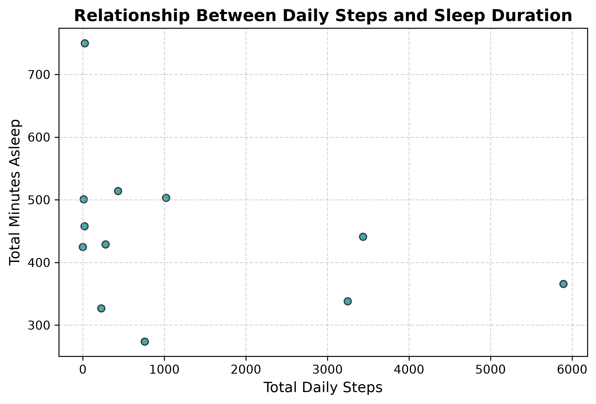

# 📊 Fitbit Fitness & Sleep Data Analysis Project

---
### 👤 Author
- **Name:** Farah
- **Role:** Data Engineering Student & Specialist
---

## 📌 Project Overview
This project focuses on executing an end-to-end Data Engineering pipeline using Python, Pandas, and Matplotlib. It analyzes daily physical activity and sleep patterns from Fitbit users to extract actionable health insights.

---

## 🛠️ Data Pipeline & Methodology (ETL Workflow)

### 1. Data Extraction & Cleaning
- **Source Files:** `dailyActivity_merged.csv` and `sleepDay_merged.csv`.
- **Date Formatting:** Converted date strings into structured Datetime objects (`pd.to_datetime`).
- **Deduplication:** Handled missing values and removed duplicate entries.

### 2. Data Integration
- **Merging Strategy:** Joined activity and sleep datasets using a composite primary key (`Id` + `ActivityDate`).
- **Output:** Cleaned dataset saved as `fitbit_cleaned_merged.csv`.

---

## 📈 Visual Analysis & Key Insights

### 1. Daily Steps vs. Sleep Duration

- **Chart Type:** Scatter Plot (`Matplotlib`).
- **Observation:** The data points show no strong linear correlation between total daily steps and sleep duration.
- **Key Insight:** Most users average between 300 to 500 minutes (5–8 hours) of sleep regardless of their daily step count.

---

## 💻 Tech Stack
- **Language:** Python
- **Libraries:** Pandas, Matplotlib
- **IDE:** Visual Studio Codess